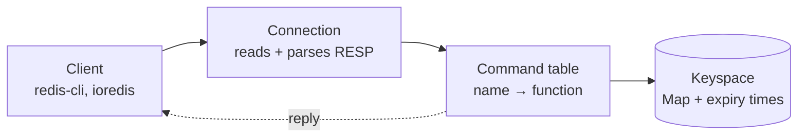

# Pebble

[](https://github.com/iivanhaj/pebble/actions/workflows/test.yml)

A Redis-compatible server, written from scratch in TypeScript on Node.js.
Real Redis clients, like `redis-cli` and the `ioredis` library, talk to it
without knowing it isn't Redis.

I'm building it to learn how Redis works on the inside: the wire protocol,
key expiry, data structures, persistence, and how a single-threaded server
can still be fast. It's a work in progress; see the [roadmap](#roadmap).

## Quick start

Needs Node.js 22 or newer.

```bash
npm install
npm run build
npm start          # listens on 127.0.0.1:6380
```

Then connect with `redis-cli` (or, without installing Redis, through Docker):

```bash
redis-cli -p 6380
docker run --rm -it redis:7-alpine redis-cli -h host.docker.internal -p 6380
```

```
127.0.0.1:6380> SET name Jahnavi EX 60
OK
127.0.0.1:6380> TTL name
(integer) 60
127.0.0.1:6380> RPUSH queue a b c
(integer) 3
127.0.0.1:6380> LRANGE queue 0 -1
1) "a"
2) "b"
3) "c"
127.0.0.1:6380> GET queue
(error) WRONGTYPE Operation against a key holding the wrong kind of value
```

## What works

| Group      | Commands                                                      |
|------------|---------------------------------------------------------------|
| Connection | `PING`, `ECHO`, `INFO`                                        |
| Keys       | `DEL`, `EXISTS`, `EXPIRE`, `TTL`, `PERSIST`                   |
| Strings    | `GET`, `SET` (with `EX`, `PX`, `NX`, `XX`), `INCR`, `DECR`, `MGET`, `MSET` |
| Lists      | `LPUSH`, `RPUSH`, `LPOP`, `RPOP`, `LRANGE`                    |
| Hashes     | `HSET`, `HGET`, `HGETALL`, `HDEL`                             |
| Sets       | `SADD`, `SREM`, `SMEMBERS`, `SISMEMBER`                       |

Replies and error messages match real Redis, so existing client libraries
work unchanged.

## How it works



- **One thread, no locks.** Like Redis, Pebble runs every command on a single
  event loop, and a command never pauses partway through. Each one finishes
  before the next starts, so every command is atomic without any locking.
- **A protocol parser that handles partial reads.** TCP can split one command
  across several packets, or pack several commands into one. The parser keeps
  leftover bytes and only runs a command once all of it has arrived.
- **Expiry, two ways.** Expired keys are deleted when someone reads them
  (lazy), and by a background sweep that samples random keys 10 times a second
  (active), the same approach Redis uses.
- **Lists on a circular buffer.** Pushing and popping at either end is O(1),
  where a plain JavaScript array would be O(n) at the front.

More detail, including the design decisions, is in
[docs/ARCHITECTURE.md](docs/ARCHITECTURE.md).

## Tests

```bash
npm test
```

82 tests: unit tests for the parser, encoder and every command; end-to-end
tests over a real TCP connection (including a command split across packets);
and tests that drive Pebble with the real `ioredis` client. They run on every
push in GitHub Actions.

## Roadmap

- [x] RESP2 protocol, including partial reads
- [x] Strings, `INCR`/`DECR`, `MGET`/`MSET`
- [x] Key expiry: lazy and active
- [x] Lists, hashes and sets
- [ ] Persistence: append-only file with `always` / `everysec` / `no` fsync policies
- [ ] Point-in-time snapshots
- [ ] Memory limit with LRU eviction (exact LRU, then Redis-style sampled LRU)
- [ ] Pub/sub
- [ ] Transactions: `MULTI` / `EXEC` / `WATCH`
- [ ] Benchmarks against real Redis with `redis-benchmark`
